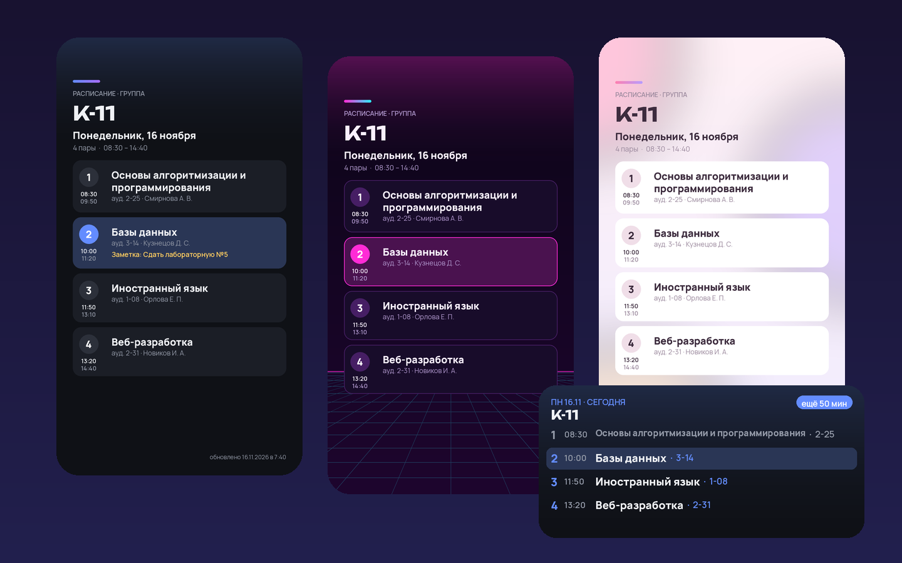
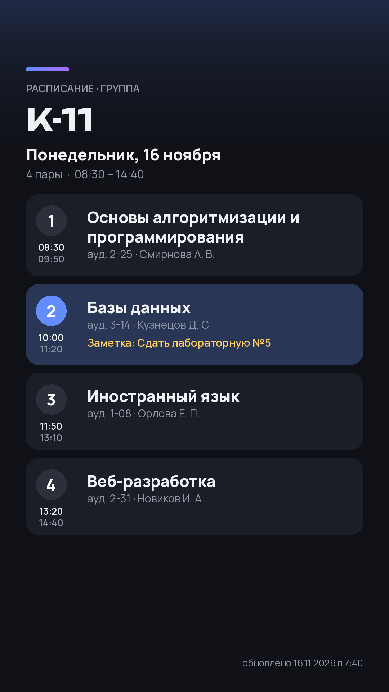
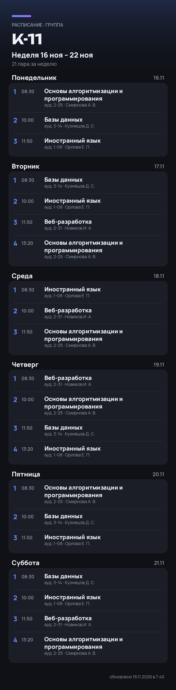
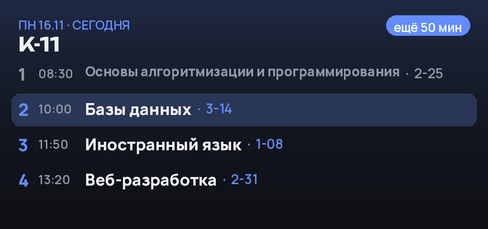
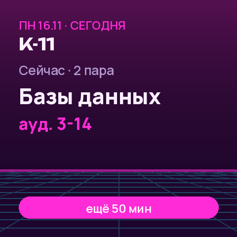

# Бот расписания колледжа

Telegram-бот, который знает расписание ВГЭК: забирает его с сайта «Экспресс-расписания», присылает замены,
рисует расписание картинкой и показывает пары прямо на экране телефона.

**Попробовать:** [@VGEKScheduleBot](https://t.me/VGEKScheduleBot)

**Стек:** Python 3.11+ · aiogram 3 · SQLite (aiosqlite) · httpx + BeautifulSoup · Pillow · aiohttp · Telegram Stars · ЮKassa



## Что умеет

**Расписание**
- 📅 Сегодня / завтра / неделя / следующая неделя с листанием, «идёт сейчас» и окна между парами.
- 👥 Для групп, 👤 преподавателей и 🚪 аудиторий; 🔎 поиск — достаточно написать «К-11» или фамилию.
- 💬 Inline-режим: `@бот К-11` в любом чате — расписание на сегодня, завтра или неделю.
- ⏰ Звонки с таймером до конца пары, 🏫 свободные аудитории на любую пару, 📍 где сейчас преподаватель,
  📊 нагрузка за неделю или месяц.

**Уведомления**
- 🔔 Замены: бот сам проверяет сайт каждые 30 минут и пишет, что поменялось.
- 🌙 Авторассылка: вечером — на завтра, утром — на сегодня, в воскресенье — на неделю.
- ⏳ Напоминания за N минут до пары и 📝 заметки к парам («сдать лабу»).

**Картинки и виджеты**
- 🖼 Расписание PNG в формате сторис — день или неделя, 8 тем (неон, пастель, тетрадь, новогодняя…),
  свой цвет акцента и фото на фоне.
- 📱 Виджет дня — закреплённое сообщение, которое само обновляется.
- 📲 Виджет на рабочий стол телефона (iPhone — Scriptable, Android — KWGT): бот отдаёт картинку по личной ссылке.

**Premium и рост**
- ⭐ Premium за Telegram Stars или 💳 картой / СБП через ЮKassa: пробный период, промокоды, подарки другу, донаты.
- 🤝 Реферальная программа (+7 дней Premium за друга) и 🏆 достижения.

**Для админа**
- 🛠 `/admin`: рассылки, блокировки, техработы, обращения пользователей с ответом из бота.
- 📈 Графики роста, активности и выручки (Pillow, без matplotlib), статистика фич.
- 💾 Ежедневные бэкапы базы с ротацией, импорт пользователей, 🚨 алерты, если сайт колледжа лёг или в коде ошибка.

| День | Неделя | Виджеты |
|---|---|---|
|  |  |   |

> Картинки — демо на выдуманных данных (`python -m scripts.render_demo`).

## Запуск

```bash
python -m venv .venv && source .venv/bin/activate
pip install -r requirements.txt
cp .env.example .env      # впиши BOT_TOKEN от @BotFather и свой Telegram ID в ADMIN_IDS
python bot.py
```

Парсер можно проверить без бота: `python -m utils.site_parser`.

## Оплата в рублях (ЮKassa)

Рубли принимаются через API ЮKassa — карта, СБП или ЮMoney, **от 1 ₽**. Встроенные платежи Telegram
для этого не подходят: они не принимают счета дешевле ~1 $, а у бота донаты от 1 ₽ и цены от 9 ₽.

Как это работает: бот создаёт платёж, присылает кнопку «💳 Оплатить» (страница ЮKassa) и сам проверяет статус
каждые 20 секунд — вебхуки и свой сервер не нужны. Неоплаченные платежи хранятся в базе, так что проверка
переживает перезапуск; через сутки неоплаченная ссылка закрывается. Покупка выдаётся ровно один раз.

1. Зарегистрируйся в [ЮKassa](https://yookassa.ru) (самозанятый, ИП или ООО) и дождись подключения магазина.
2. Личный кабинет → **Интеграция → Ключи API**: скопируй `shopId` и выпусти секретный ключ.
   Для проверки заведи тестовый магазин — там свои ключи и тестовые карты.
3. Впиши в `.env`: `YOOKASSA_SHOP_ID=…` и `YOOKASSA_SECRET_KEY=…`, перезапусти бота.

После этого у каждого товара два способа оплаты: «⭐ Звёздами» или «💳 Картой, СБП или ЮMoney».

| Товар | Звёзды | Рубли |
|---|---|---|
| Premium на месяц | 15 ⭐ | 29 ₽ |
| Premium на год | 99 ⭐ | 199 ₽ |
| Premium навсегда | 199 ⭐ | 399 ₽ |
| Тема картинок | 5–15 ⭐ | 9–29 ₽ |
| Донат | от 1 ⭐ | от 1 ₽ |

Цены меняются в `utils/premium.py` (`PLANS`, `THEMES`, `RUB_PLANS`, `RUB_THEMES`). Донат — любая сумма:
быстрые кнопки или «✍️ Своя сумма» (`50` — звёзды, `150 р` — рубли).

- **Чеки (54-ФЗ).** Самозанятым с «Чеками от ЮKassa» ничего делать не нужно (`YOOKASSA_RECEIPT=0`).
  Для ИП/ООО с онлайн-кассой поставь `YOOKASSA_RECEIPT=1`: бот один раз спросит почту и передаст данные чека.
- **Выручка** в админке и на графиках считается отдельно по звёздам и рублям.
- **Возвраты** — кнопкой ↩️ в админке: звёзды через Telegram, рубли через API ЮKassa;
  купленное забирается, покупателю приходит сообщение.

## Структура

```
bot.py              точка входа: бот, диспетчер, запуск модулей
config.py           настройки из .env
modules/            фичи — у каждой свой файл и роутер (расписание, звонки, Premium, админка…)
utils/
├── site_parser.py  парсер «Экспресс-расписания» (идёт по странице потоком — не зависит от вёрстки таблиц)
├── db.py           SQLite: пользователи, пары, заметки, покупки
├── formatting.py   оформление сообщений: даты по-русски, «идёт сейчас», окна
├── image.py        картинки-расписания, themes.py — темы, widget_image.py — виджеты
└── charts.py       графики для админки
fonts/              Manrope, Unbounded, Caveat (OFL)
scripts/            демо-картинки для README
tests/              pytest: парсер, форматирование, картинки во всех темах, оплата, сборка роутеров
```

## Проверки

```bash
pip install pytest ruff
ruff check .   # линтер
pytest -q      # тесты
```

CI (`.github/workflows/ci.yml`) на каждый пуш запускает линтер, тесты и рендер демо-картинок.
